<p align="center">
  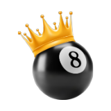
</p>

<h1 align="center">THE GILDED RAIL</h1>
<p align="center"><strong>PRIVATE BILLIARD CLUB · EST. 1924</strong></p>
<p align="center"><em>A quiet table. An honest wager.</em><br>
A browser-based 3D pool game with a full club to explore, a career to climb, and a table to make your own.</p>

<p align="center">
  <a href="#enter-the-club">Run locally</a> ·
  <a href="#at-the-table">Game modes</a> ·
  <a href="#the-equipment-atelier">Equipment</a> ·
  <a href="#the-clubs-art-collection">Artwork</a> ·
  <a href="#development--verification">Development</a>
</p>

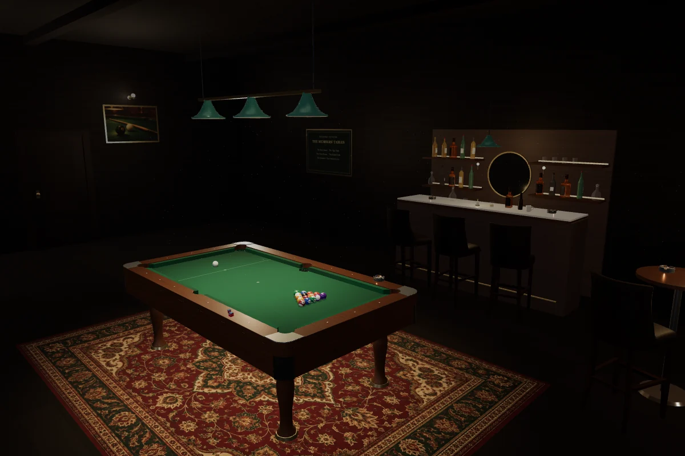

<p align="center"><sub>Actual in-game capture · Three.js r128 · Desktop & touch controls · Optional online rooms</sub></p>

---

## At the table

| A way to play | What awaits |
| :--- | :--- |
| **Career** | Five leagues, 25 distinct opponents and five bosses. Work from the Back Room toward the Gilded Circle and Midnight Shark. |
| **Quick match** | Three CPU difficulties, or two players sharing one device. |
| **Private rooms** | Invite a friend with a six-character code; optional member accounts, cloud saves and room chat. |
| **8-ball & English pool** | Numbered solids/stripes or reds/yellows, with fouls, ball in hand and optional called pockets. |
| **9-ball** | Play the lowest ball first and work toward the nine. |
| **Practice & trick shots** | Explore the table freely or take on seven prepared shot layouts. |

The physics models regulation-size 57.15 mm balls, sliding and rolling friction,
cushion response, side spin, follow, draw and off-table scratches. XP, achievements
and daily/weekly challenges unlock equipment and profile cosmetics.

## A club with a history

Warm enamel pendants light the cloth. Rain gathers on the window. The clock keeps
local time; framed paintings, the founding charter and members’ notices give the
surrounding room its own character.

The table has polished timber, flush mother-of-pearl sights, turned legs,
leather-lined pocket mouths and **open, modelled cotton nets**. Potted balls travel
to a recessed return cabinet with a real chute aperture, supported metal tracks,
a padded stop and restrained glazing. Its feed preserves scoring order and keeps
all fifteen balls separated.

| The pocket | The return cabinet |
| :---: | :---: |
| 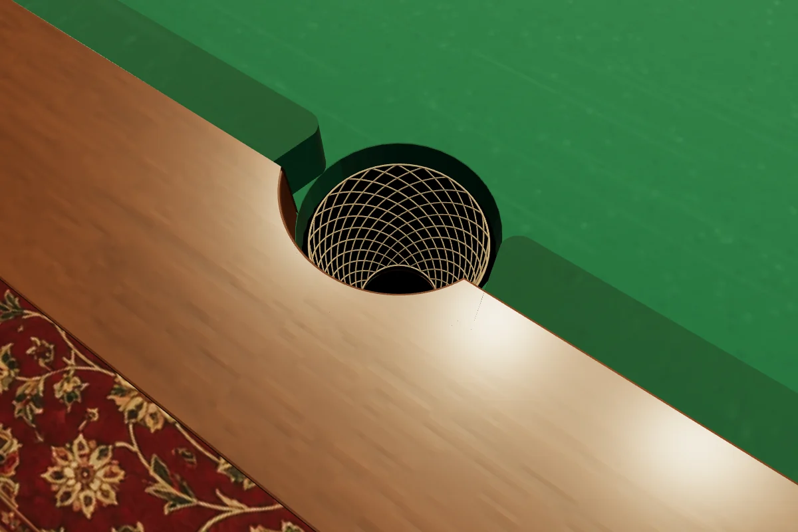 | 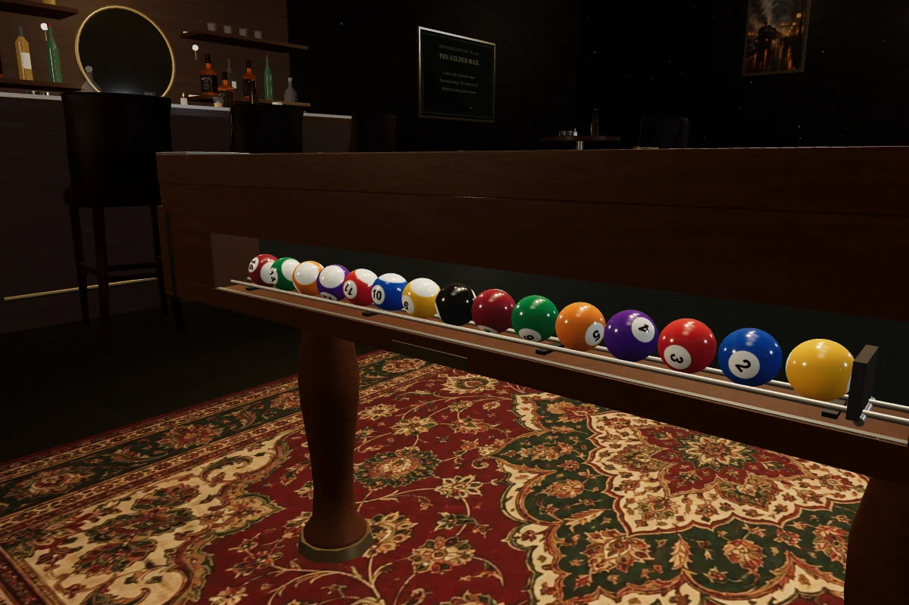 |

<details>
<summary><strong>Room details: the clock and rainy window</strong></summary>

| A clock that keeps local time | Rain on the glass |
| :---: | :---: |
| 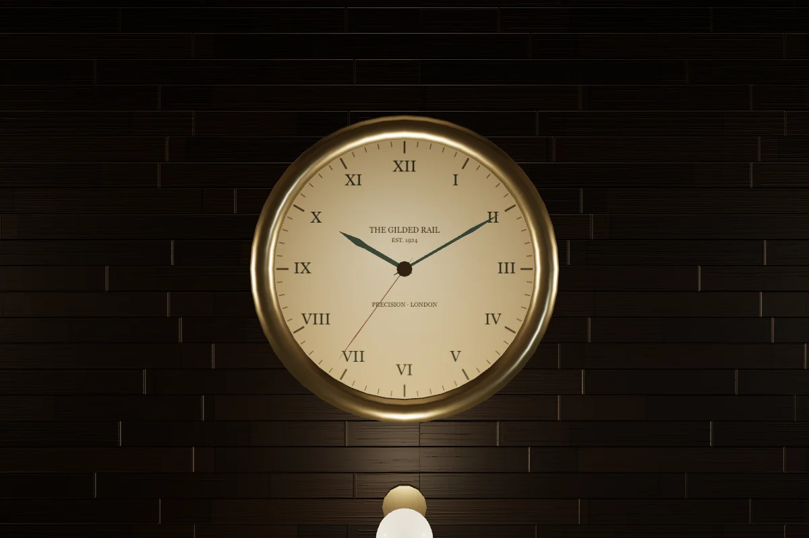 | 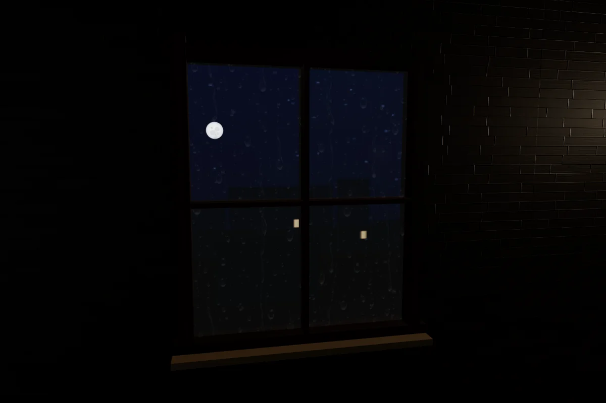 |

</details>

## The equipment atelier

**21 cloths · 19 cues · 12 timber finishes**

Combine traditional house equipment with late-career effects. The Founders’ Cue,
Harbormaster and Midnight Regent feature generated Art Deco marquetry; Founders’
Green, Harbor Petrol and Reserve Claret add understated worsted cloths with their
own club stories. Equipment selection changes the actual rendered materials.

Search and unlocked-only filters remember each category. Proportionate previews,
compact dialogs and a slim match HUD keep the table readable. The locally bundled
**Driver.js** guide highlights the real controls and pauses offline play while
teaching them.

| The atelier | The members’ interface |
| :---: | :---: |
| 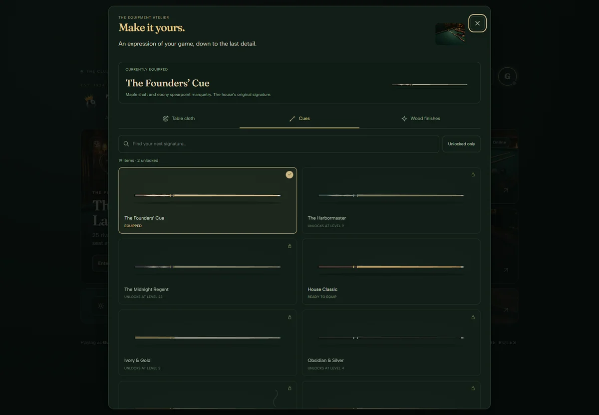 | 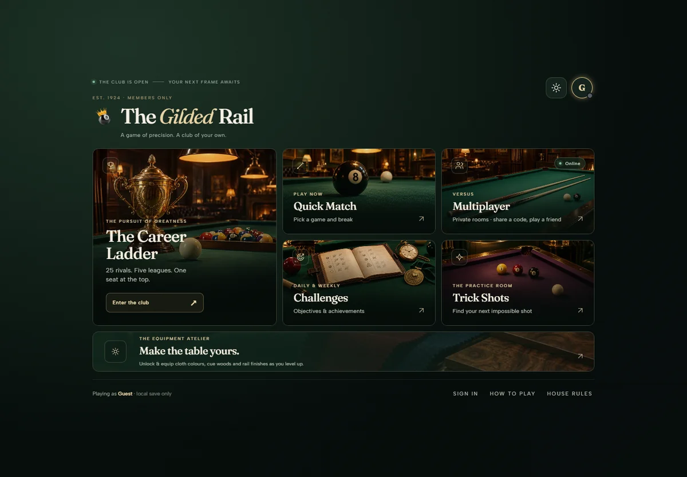 |

## The club’s art collection

The collection combines **52 optimized interface images** with **11 world
textures and paintings**. These images were made with the built-in imagegen tool;
the final prompts are preserved for future art direction. The paintings below
are generated artwork also displayed inside the 3D room.

| Harbor Nocturne | Champions’ Study |
| :---: | :---: |
| 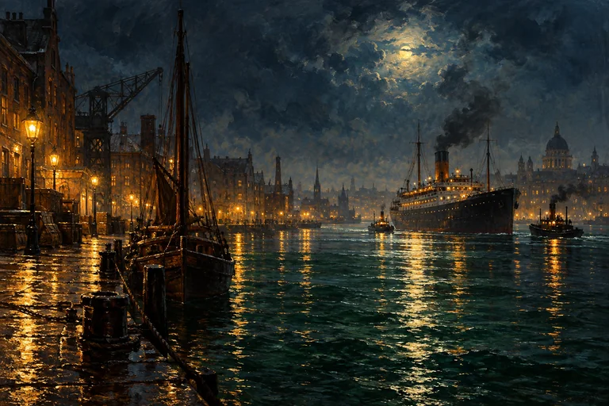 | 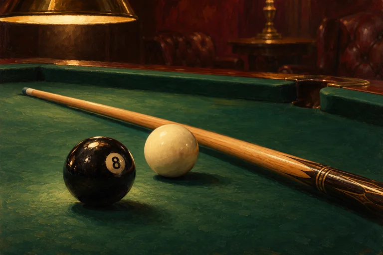 |

<p align="center">
  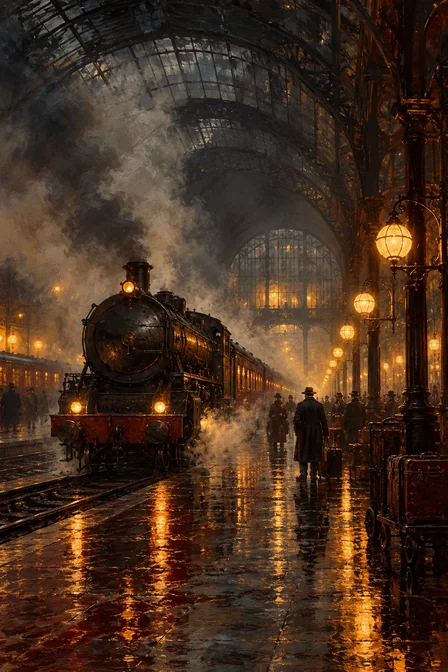
  
</p>

<details>
<summary><strong>Materials, portraits and production notes</strong></summary>

| Surface | Material study |
| :--- | :--- |
| Neutral walnut grain | 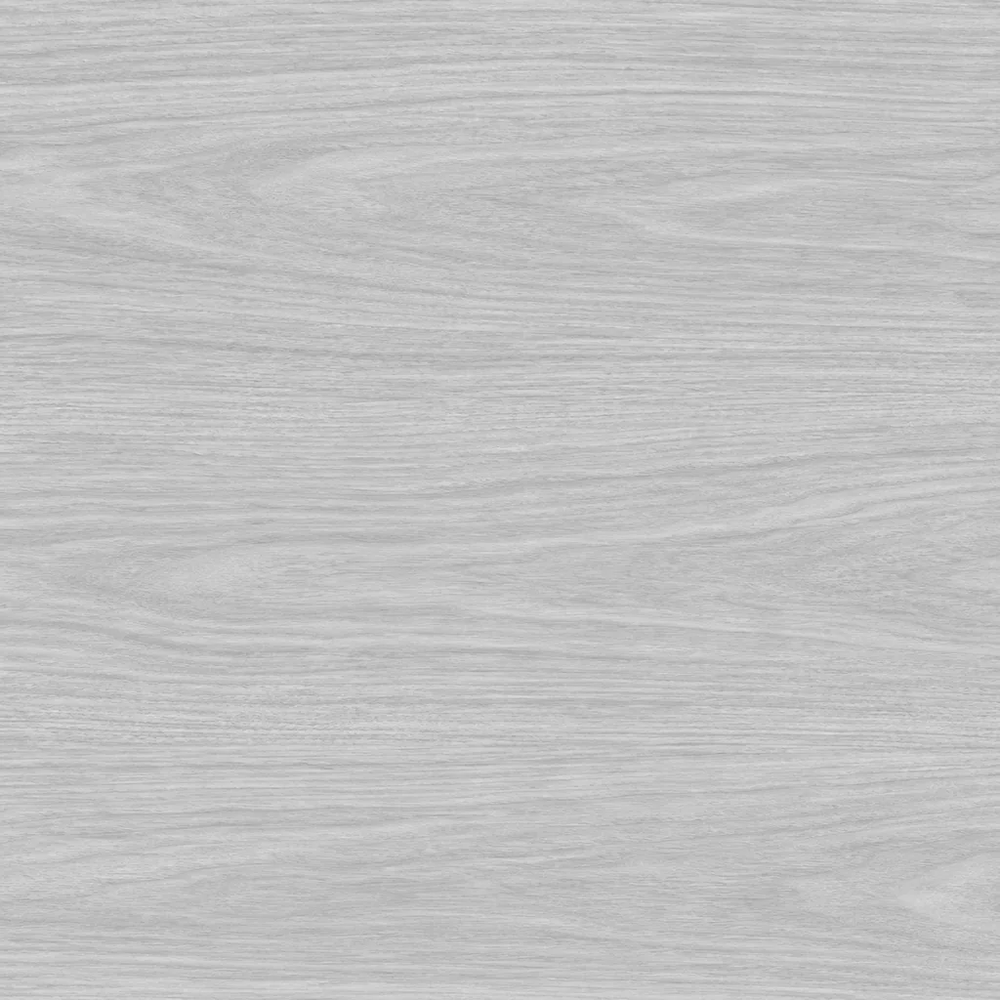 |
| Cue marquetry | 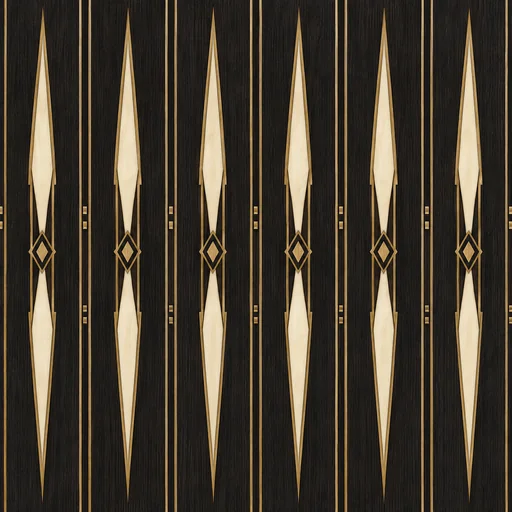 |
| Club rug | 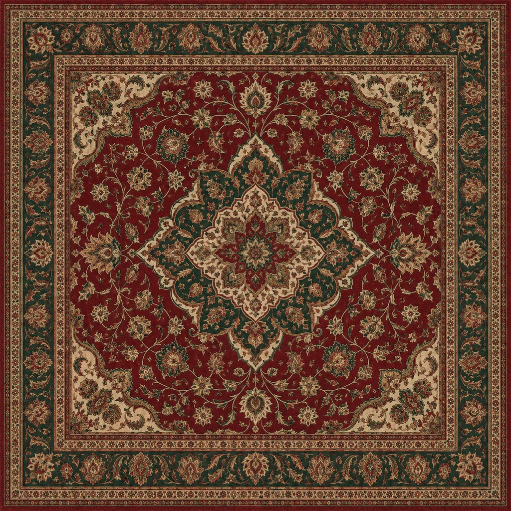 |

Career portraits follow each character’s identity: Shark opponents are dressed
anthropomorphic sharks, profession-based characters wear period attire, and the
later leagues take a darker, more mysterious direction.

- [World materials and geometry notes](the-gilded-rail/docs/WORLD-FIDELITY.md)
- [Interface and onboarding notes](the-gilded-rail/docs/UI-REFRESH.md)
- [World image prompts](the-gilded-rail/docs/world-art-prompts.json)
- [Latest paintings, rain and enamel prompts](the-gilded-rail/docs/fidelity-art-prompts.json)
- [Interface art prompts](the-gilded-rail/docs/interface-art-prompts.json)
- [Character and collection prompts](the-gilded-rail/docs/ui-art-prompts.json)
- [World asset dimensions and byte counts](the-gilded-rail/public/assets/world/manifest.json)

</details>

## Enter the club

From the repository root, with Node.js 20.19+ or 22.12+ and npm installed:

```sh
cd the-gilded-rail
npm ci
npm run dev
```

Open the local address printed by Vite. Serve the game over HTTP; opening the HTML
with `file://` does not support its asset-loading flow.

Guest progress stays in browser storage. Accounts, cloud saves and private rooms
use Supabase and hCaptcha; they need network access and a correctly configured
backend. For your own deployment, review
[the account configuration](the-gilded-rail/src/engine/02a-account.js),
[online-room implementation](the-gilded-rail/src/engine/21c-online.js) and the host’s security headers.

### Controls

| Action | Keyboard / mouse |
| :--- | :--- |
| Aim | Drag on the table, or use ← / → |
| Charge and shoot | Hold Space, then release |
| Fine aim / spin | E; focus the spin pad and use arrows, or Home to center |
| Change view | Tab |
| Move / look | WASD and drag in walk view |
| Zoom | Mouse wheel; pinch on touch screens |
| Aim-guide detail | G |
| Hide / show HUD | H |
| Match menu | Escape |

Touch players get on-screen controls for movement, aiming, spin and shot power.
Settings include sound buses, control tuning, high-contrast ball labels, graphics
presets and optional depth of field.

## Development & verification

| Command, inside `the-gilded-rail/` | Purpose |
| :--- | :--- |
| `npm run dev` | Vite serves the multi-file source. |
| `npm run build` | Creates the deployable `dist/` directory. |
| `npm test` | Headless core flow and 141 feature checks. |
| `node tools/pause-test.cjs` | Checks CPU scheduling and pause/resume behavior. |
| `node tools/ui-review.mjs http://127.0.0.1:5175/` | Edge browser review across four desktop/touch viewports. |
| `node tools/world-review.mjs http://127.0.0.1:5175/` | Actual WebGL material lifecycle checks and close-up captures. |

For production review, run `npm run build`, then serve the result:

```sh
python -m http.server 5175 --bind 127.0.0.1 --directory dist
```

Browser reviews use installed Microsoft Edge through Playwright. The UI suite
stubs hCaptcha and uses local room state; it does not create accounts or prove
live multiplayer connectivity. The world suite checks texture disposal and stable
GPU texture counts, rather than claiming a hardware-independent frame rate.

### Rendering and assets

World images are bounded WebP files with mipmaps and capped anisotropy. Materials
share loaded textures; old felt maps are disposed when replaced. Net strands are
merged into two reusable geometries, and rail sights use one instanced draw call.
Low quality disables shadows and post-processing; higher presets add soft shadows,
bloom and optional depth of field.

```text
the-gilded-rail/
├── index.html                 # HTML shell and ordered engine scripts
├── src/engine/                # Numbered, shared-scope Three.js engine files
├── src/styles/                # Base, collection and interface styles
├── public/assets/
│   ├── world/                 # Materials and framed paintings
│   ├── ui/collection/         # Menu artwork and character portraits
│   ├── models/                # GLB room props
│   └── audio/                 # Soundtrack and effects
├── vendor/                    # Local runtime libraries and Driver.js license
├── docs/                      # Screenshots, prompts and implementation notes
└── tools/                     # Builder, art exporters and regression reviews
```

Engine scripts share one global scope and load in filename order. Add files to
`index.html` in that same order; the custom builder collects and inlines them.
See [the module migration guide](the-gilded-rail/MIGRATION.md) for a future ES module
conversion.

### Deploy

On Vercel, set the project root to `the-gilded-rail`; the included
[configuration](the-gilded-rail/vercel.json) builds and serves `dist/`. Other
static hosts can serve the same directory.

Deploy **all of `dist/`**. CSS and scripts are inlined into the HTML, while
images, models and audio remain external assets. Installing or building synchronizes
the pinned Driver.js distribution into `vendor/`; onboarding uses no CDN.

### Audio and third-party assets

The original project includes a copyrighted soundtrack. Replace it with a recording
you are licensed to distribute before public release. The soundtrack URL is set by
`window.__SONG` in `index.html`. Review the rights for bundled third-party
models and audio when redistributing them. Driver.js includes its
[MIT license](the-gilded-rail/vendor/driver-LICENSE.txt).

---

<p align="center"><em>The harbor sleeps. The club does not.</em></p>
